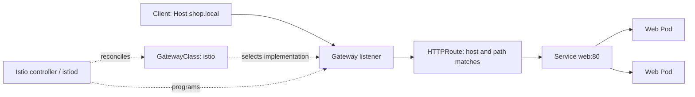

# Kubernetes ingress and Gateway API with Istio

## Ingress: the basic idea

Applications in Kubernetes usually run in Pods with changing IP addresses. A Kubernetes `Service` gives a group of Pods a stable in-cluster address. To accept web traffic from outside the cluster and direct it to Services, a cluster needs an edge entry point and a routing implementation.

An **Ingress** is a Kubernetes API object for describing HTTP and HTTPS rules such as “requests for `shop.local` with path `/` go to Service `web`.” The object is declarative configuration; it does not run a proxy and does not make traffic flow by itself. An **Ingress controller** watches the Kubernetes API, reads Ingress objects, and configures or operates a data plane proxy to implement those rules.

```text
Client ──> external address / load balancer ──> ingress proxy
                                                   │ reads rules
                                  Ingress objects ──┘
                                                   │ forwards to
                                                   v
                                           Kubernetes Service ──> Pods
```

The controller and proxy are often delivered together, but they are different responsibilities: the controller is the reconciliation logic; the proxy handles the packets and HTTP requests. A `Service` of type `LoadBalancer`, NodePort, host networking, or a local port-forward can provide access to the proxy, depending on the environment.

### Common ingress controller types

These categories describe how an implementation provides the data plane and connects to the infrastructure. Products can combine more than one pattern.

| Type | How it handles traffic | Typical fit |
|---|---|---|
| Proxy-based controller | Watches Kubernetes resources and programs a reverse proxy such as NGINX, HAProxy, or Envoy. | Portable clusters where teams manage the proxy and its configuration. |
| Cloud load-balancer controller | Reconciles Kubernetes routes and cloud resources, often provisioning a managed Layer 7 load balancer. | Cloud environments where the provider should own the external load balancer. |
| Service-mesh ingress gateway | Uses a mesh data plane proxy at the cluster edge and connects routing to mesh capabilities such as identity and policy. Istio can do this with Gateway API. | Clusters already using a service mesh, or teams adopting mesh traffic management. |
| Lightweight or distribution-integrated controller | Ships with a local Kubernetes distribution or development environment and may be enabled as an add-on. | Local development, edge, and small clusters. |

The Kubernetes Ingress API is stable but frozen, and Kubernetes recommends Gateway API for new development. Ingress remains widely deployed, so learning to read it and migrate it is useful. **Ingress-NGINX was retired in March 2026**; the lab's NGINX steps are for comparison and migration practice only, not a recommendation for a new deployment. See the [Kubernetes Ingress documentation](https://kubernetes.io/docs/concepts/services-networking/ingress/) and [Ingress-NGINX retirement statement](https://kubernetes.io/blog/2026/01/29/ingress-nginx-statement/).

## Gateway API: the main focus

Gateway API is a Kubernetes networking API for describing how traffic enters a cluster and reaches Services. It evolves the Ingress model into a set of related resources with clearer responsibilities and role-oriented ownership. The API is implementation-neutral: an installed controller, such as Istio, interprets the resources and configures the data plane.

### Core resources

- **`GatewayClass`**: identifies the controller implementation responsible for a class of gateways. In this lab Istio provides the `istio` class.
- **`Gateway`**: requests/configures a network gateway, including listeners such as HTTP on port 80 or HTTPS on port 443. With Istio's default Gateway API deployment model, creating this resource also causes Istio to provision a gateway Deployment and Service.
- **`HTTPRoute`**: defines HTTP matching and forwarding rules. It can match hostnames, paths, headers, or query parameters and send matching requests to backend Services.
- **`ReferenceGrant`** (when needed): grants permission for certain cross-namespace references. The lab keeps the Gateway, Route, and backend Service in one namespace, so it does not need this resource.

The `Gateway` and `HTTPRoute` connect using `parentRefs`. The Gateway's `allowedRoutes` controls which namespaces and route kinds may attach. This separation allows platform owners to manage shared listeners while application teams manage their own routes, subject to those attachment rules.



At runtime, the controller observes the desired resources and configures the proxy. A request reaches the gateway's listener; the gateway evaluates the attached HTTPRoute, chooses a matching backend, and proxies the request to the Service's ready endpoints. Kubernetes status conditions report whether resources were accepted and programmed. For this lab, check `Accepted=True` and `Programmed=True` on the Gateway, and `Accepted=True` plus `ResolvedRefs=True` on the HTTPRoute.

Gateway API has stable core APIs such as `Gateway` and `HTTPRoute`, while additional features may be provided by implementation-specific policies and extensions. Standard APIs improve portability but do not guarantee that every feature or edge behavior is identical across controllers. Always verify the capabilities of the chosen implementation.

## What Istio is

Istio is an open-source service mesh. It can manage traffic inside a cluster and at the cluster edge, and can add capabilities such as workload identity, encrypted service-to-service communication, and policy enforcement. Istio has two main architectural pieces:

- **Control plane (`istiod`)**: watches Kubernetes and Istio configuration, validates and translates it, and sends configuration to proxies.
- **Data plane (Envoy proxies)**: handles actual network traffic. In this lab, an Envoy-based Istio gateway receives external HTTP traffic and forwards it to the app Service.

Istio supports both its own traffic-management APIs and the Kubernetes Gateway API. This lab uses Gateway API resources, so the routing configuration is expressed in standard Kubernetes resources while Istio supplies the controller and proxy. Istio's minimal profile installs the control plane; applying the Gateway results in an Istio-managed gateway Deployment and Service. This is distinct from manually installing a fixed ingress-gateway Deployment first.

The sample app in this lab is **not enrolled in the service mesh**. Istio is acting as the edge gateway and routing to the Kubernetes Service. Sidecar injection and mesh-internal security/traffic features are outside the lab's scope.

## How the lab works

The companion [hands-on lab guide](ingress-to-gateway-api-kind-lab.md) creates a three-node kind cluster, deploys a small app with two replicas, and keeps the app Service stable while changing the edge routing layer.

```text
First:  curl + Host shop.local -> Ingress-NGINX -> Ingress -> Service web -> Pods
Then:   curl + Host shop.local -> Istio gateway -> HTTPRoute -> Service web -> Pods
```

kind runs Kubernetes nodes as containers on your computer. The lab uses `kubectl port-forward` to reach each proxy on `localhost:8080`, so it does not need a cloud load balancer. The request includes `Host: shop.local`; that header is needed to match the configured hostname. The application Service and Pods stay the same during migration, isolating the change to the routing API and proxy implementation.

The Gateway API portion of the lab follows this resource relationship:

```yaml
# Simplified relationship; see the full manifest in the lab guide.
Gateway:
  gatewayClassName: istio
  listener: HTTP shop.local:80
HTTPRoute:
  parentRef: shop
  hostname: shop.local
  match: PathPrefix /
  backendRef: web:80
```

## Migration: Ingress to Gateway API

Migration is a behavior-mapping exercise. The basic host and path rule in this lab maps cleanly from an Ingress rule to a Gateway listener plus HTTPRoute rule. Real Ingress deployments may also rely on controller-specific annotations, ConfigMaps, or custom resources for features such as rewrites, TLS, authentication, timeouts, rate limits, and request-size controls. Those behaviors need to be inventoried, mapped to supported Gateway API features or Istio policies, and tested individually; there is no universal one-to-one conversion.

The practical sequence is:

1. Inventory Ingress objects, classes, annotations, and controller-specific configuration.
2. Create the target `GatewayClass`/`Gateway` and equivalent `HTTPRoute` resources.
3. Validate attachment and reference status conditions.
4. Send representative requests and compare response codes, headers, redirects, TLS, and backend behavior.
5. Shift traffic to the new gateway and monitor it.
6. Remove the old Ingress resources and controller only after validation succeeds.


---

## Lab Overview

1. Create a kind cluster using `kind-cluster.yaml`.
2. Deploy services and pods (assumed pre-existing or separately managed).
3. Deploy an NGINX ingress resource using `ingress.yaml`.
4. Verify access via NGINX Ingress Controller.
5. Deploy Gateway API resources (`Gateway` and `HTTPRoute`) using `gateway-route.yaml` configured with Istio GatewayClass.
6. Verify access through Gateway API implementation.

---

## Commands Used

```bash
# Create Kind cluster
kind create cluster --config kind-cluster.yaml

# Apply NGINX ingress resource
kubectl apply -f ingress.yaml

# Check ingress
kubectl get ingress -n lab

# Apply Gateway API resources
kubectl apply -f gateway-route.yaml

# Check gateway and routes
kubectl get gateway -n lab
kubectl get httproute -n lab

# Test access via host 'shop.local'
curl http://shop.local
```

---

## References
- [Kubernetes Ingress](https://kubernetes.io/docs/concepts/services-networking/ingress/)
- [Gateway API](https://gateway-api.sigs.k8s.io/)
- [Istio Gateway](https://istio.io/latest/docs/concepts/traffic-management/#gateway)